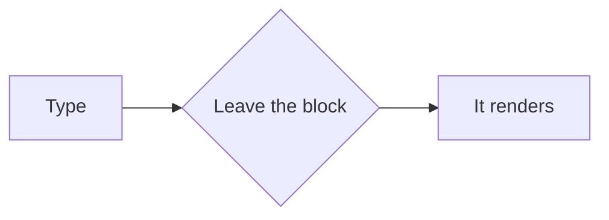

# Live tour

A paragraph with **bold**, *italic*, `inline code`, ~~struck~~ and ==marked== words, a [link to Tinta](https://example.com/tinta), a [[Plans]] note and a footnote.[^1]

## Lists

- First item with *emphasis*
- Second item
  - Nested item
- Third item

1. One
2. Two
3. Three

- [ ] Write the tour
- [x] Draw the page
- [ ] Ship it

## Quotes and callouts

> A quote that runs long enough to wrap onto a second line when the window is narrow, so its bar runs down both.

> [!NOTE]
> Live keeps the Markdown as the document.

## Code

```cpp
int main() {
    return 0;  // a comment
}
```

## Table

| Block | Drawn by |
| --- | --- |
| Paragraph | the page |
| Caret block | the live text |

## Diagram



## Math

Inline $e^{i\pi} + 1 = 0$ and a block:

$$
\int_0^1 x^2 \, dx = \frac{1}{3}
$$

## Picture


---

The last paragraph, after a divider.

[^1]: The footnote's text.
