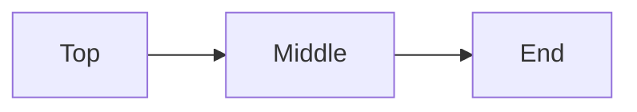

# Long read

A document several screens long, for scrolling Live's page (#307): drag the scrollbar at the right edge, turn the wheel, and walk to the end with the arrow keys, before and after a visit to the source with **Ctrl+/**. The page should go where it is taken and stay there.

## Getting around

Live is the page as it reads, typed in where it reads. The *scrollbar* at the window's right edge takes the pointer as it does in the reader: the thumb drags, and a press on the track moves the thumb there. The text's beam stops short of it, so a press there never moves the caret.

The wheel scrolls the page from anywhere on it. After **Ctrl+/** shows the source and **Ctrl+/** brings Live back, the wheel still scrolls, and the page stays where the wheel leaves it.

- The thumb drags
- A press on the track jumps there
- The wheel scrolls, before and after the source
  - and the page stays where it is left

## Walking with the keys

Down goes from line to line and from block to block, and the page follows the caret so it stays in view. Pressed all the way to the end, the caret reaches the last line with the page under it, and the next frame leaves it there instead of going back to the top.

1. Down to the end
2. Up a few lines
3. The caret stays on the screen

> A quote in the middle of the walk, long enough to wrap onto a second line in a narrow window, so the page has a block of another kind to step through.

## A table on the way

| Gesture | Before the source | After the source |
| --- | --- | --- |
| Drag the thumb | scrolls | scrolls |
| Turn the wheel | scrolls | scrolls |
| Down to the end | follows the caret | follows the caret |

The table reads as a table until the caret steps into it, and then shows its Markdown. Either way the page under it keeps its place.

## Code on the way

```cpp
// The page scrolls on its own; the source keeps its own place
float pageScroll = 0.0f;
float sourceScroll = 0.0f;
```

A code block opens as its source too, on its background, and the arrow keys walk through its lines one by one.

## More to read

Paragraphs make the page long enough to need its scrollbar several times over. This one talks about nothing in particular, which is what a long note often does: a thought, then another, then a [link to Tinta](https://example.com/tinta) and a [[Plans]] note for good measure.

Another paragraph with ~~struck~~ and ==marked== words, and `inline code` among them, so the lines carry the marks Live hides while the caret is elsewhere and shows while it is on them.

- [ ] A task to tick
- [x] A task ticked
- [ ] Another one

## Further down

The page keeps going. Each heading here is a stop on the way down, and each paragraph a few lines of text to scroll past. A reader skims; Live lets the same reader stop anywhere and type.

> [!NOTE]
> A callout on the way down. It draws as a box in the reader and in Live, and as its Markdown while the caret is in it.

Two more sentences for the road. The end is not far now.

## A detour

Not every note goes straight to its point. This one takes a detour through a list of things worth remembering, nested the way notes nest when one thought leads to another:

- Scrolling
  - with the thumb, dragged or pressed on its track
  - with the wheel, a few lines at a time
- Walking
  - with Down, line by line and block by block
  - with Page Down, a screen at a time
- Switching
  - **Ctrl+/** between Live and the source, the caret keeping its place

> The page and the source each keep their own place. Switching between them carries the caret across, at its height in the window, and nothing else.

## Another stretch

A paragraph to scroll past, written only to be scrolled past. It mentions *emphasis*, **strong words** and a [link that goes nowhere in particular](https://example.com/nowhere), so that even the filler carries the marks a real note would.

And one more, a little shorter, before the last stops on the way down.

## Nearly there

A last few paragraphs, so the end is well below the first screen. Scrolling there with the wheel, the thumb or the keys should all arrive at the same place: the diagram below and the line after it.

Then the diagram, which opens as its Markdown with its drawing kept under it, so the page grows while the caret is in it and the scrollbar and the wheel reach the new end.

## The end



The last line of the long read.
