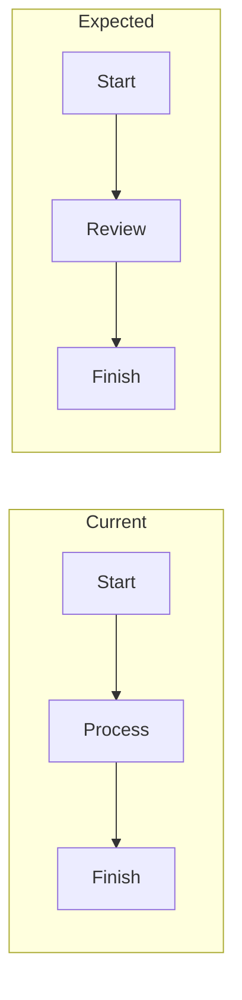
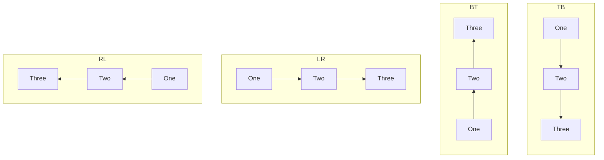
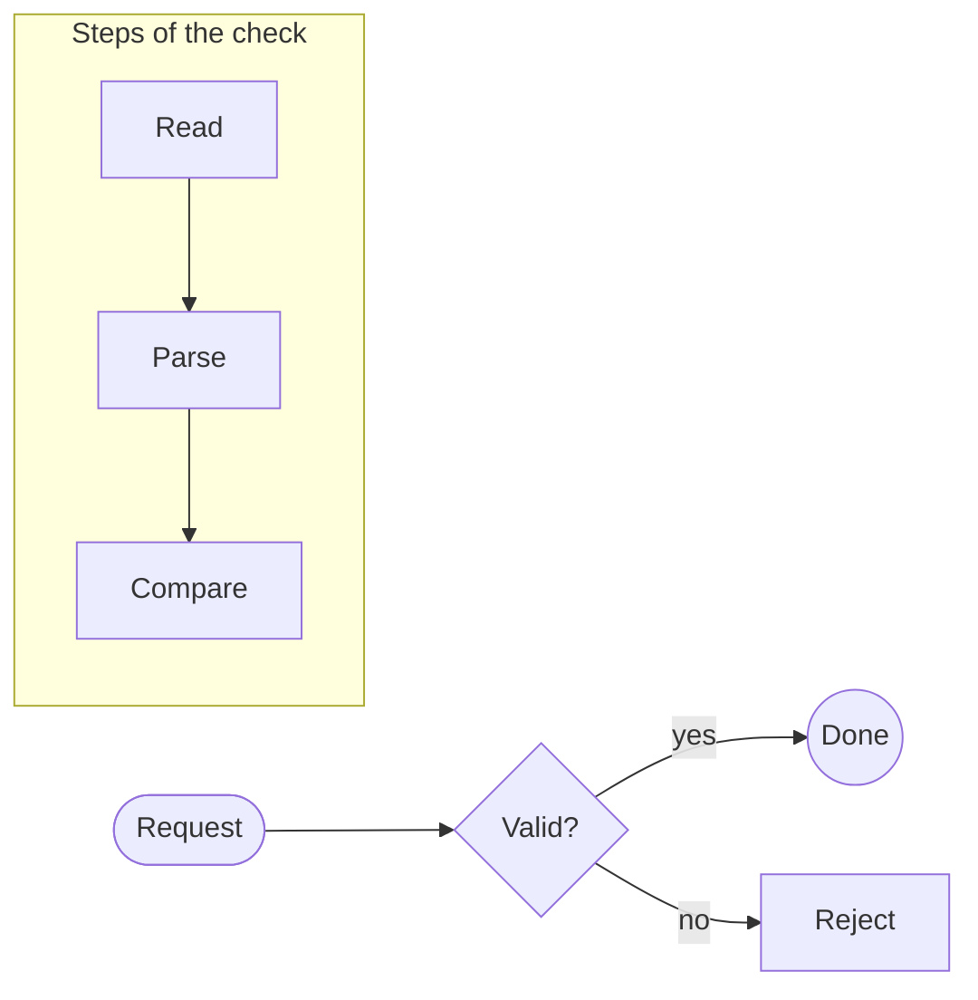
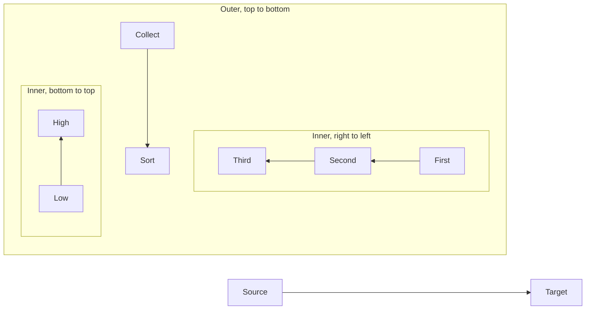
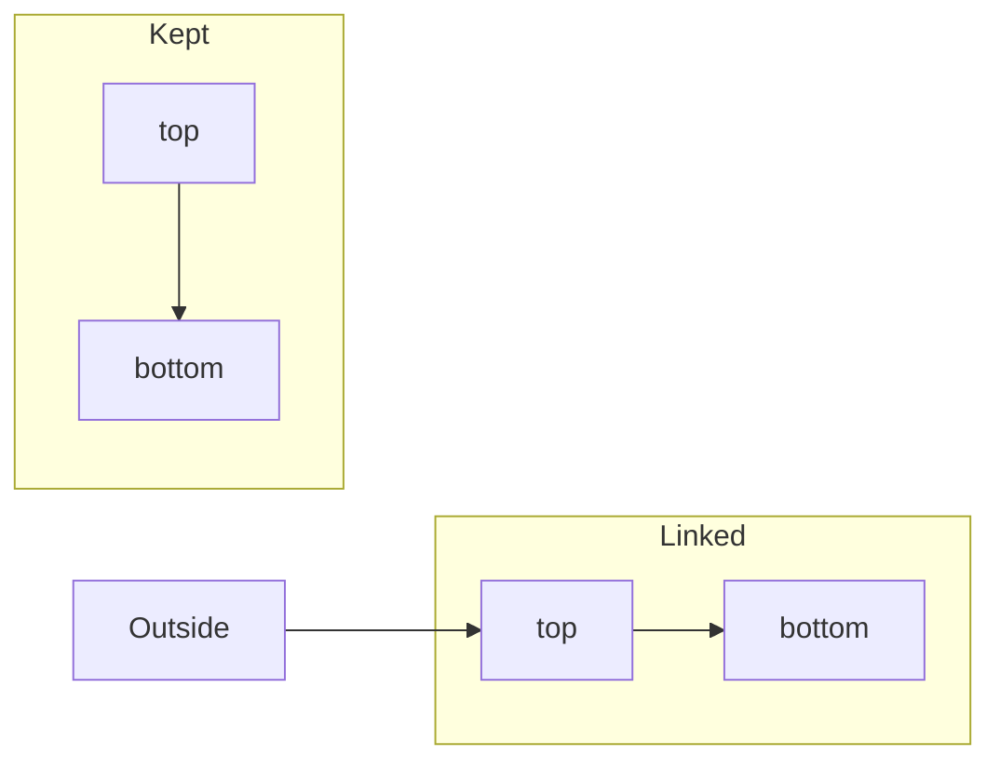
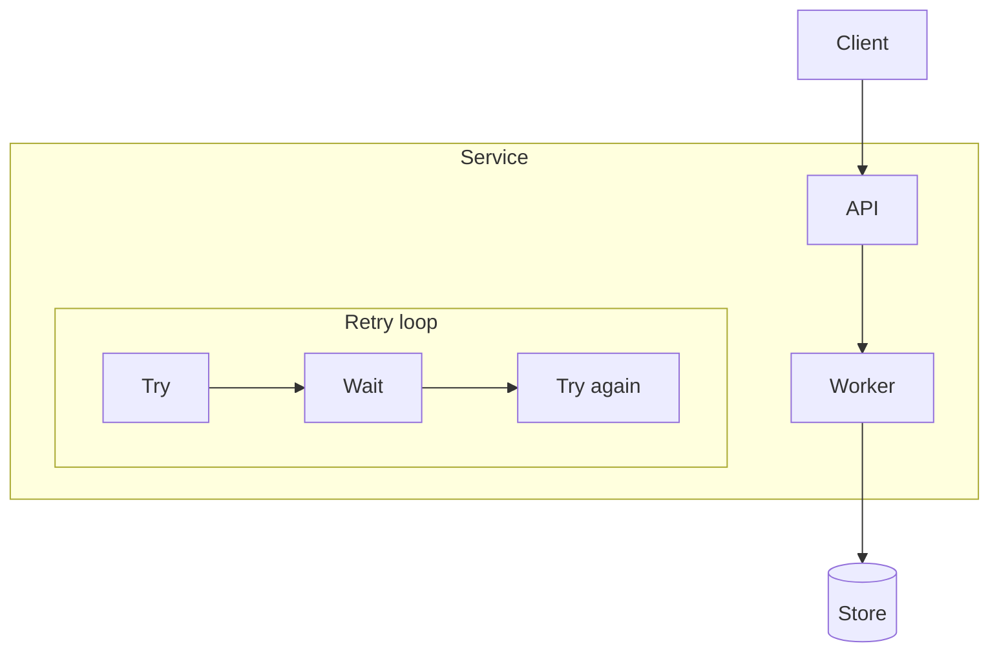
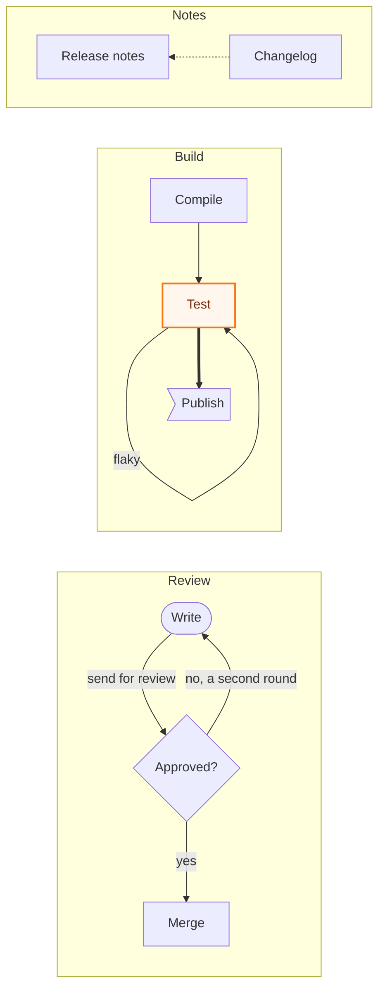
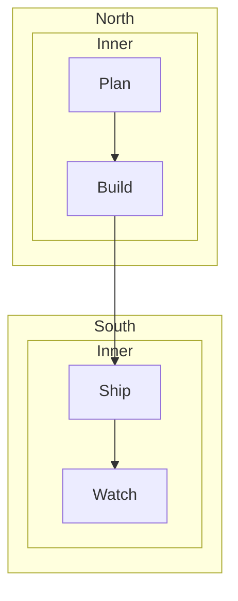
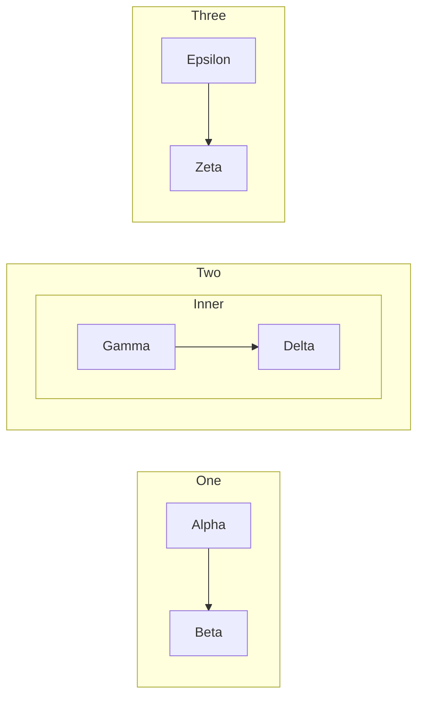

# Subgraph directions (#326)

A flowchart `subgraph` may carry a `direction` of its own. A group whose
nodes link **only to each other** is laid out along that direction and
then set into the diagram as one block; the diagram keeps *its* direction
for everything else. See Mermaid's
[direction in subgraphs](https://mermaid.js.org/syntax/flowchart.html#direction-in-subgraphs).
Every fence below but the last draws as a diagram.

## The reported sample

The diagram runs left to right, so its two unlinked groups share the first
rank and stack, as two unlinked nodes do. Inside each group the steps run
**top to bottom**.



The same groups with no `direction` follow the diagram, left to right. The
two boxes stay clear of each other:


## All four directions

| Statement | Runs | First node sits |
| --- | --- | --- |
| `direction TB` or `direction TD` | top to bottom | at the top |
| `direction BT` | bottom to top | at the bottom |
| `direction LR` | left to right | on the left |
| `direction RL` | right to left | on the right |

In a top-to-bottom diagram the four groups sit side by side:



`TD` is `TB`, and a group may sit beside linked nodes of the diagram:



## Nested groups

1. The outer group runs top to bottom.
2. Inside it, one group runs right to left and one bottom to top.
   - Each inner group is a block of the outer one.
   - The outer group is a block of the diagram.
3. `Source` and `Target` follow the diagram, left to right.



> A group with no `direction` inside a group that has one follows that
> group:
>
> ```mermaid
> flowchart TB
>     subgraph lane [Lane, left to right]
>         direction LR
>         p1[Draft] --> p2[Review]
>         subgraph sign [Sign-off]
>             p3[Approve] --> p4[Publish]
>         end
>         p2 --> p3
>     end
>     Start[Start] --> End[End]
> ```

## A group linked to the outside

Mermaid ignores the `direction` of a group when one of its nodes is linked
to a node outside it, and the group takes its parent's direction. Here
`Kept` has no such link and stays top to bottom; `Linked` is entered from
`Outside` and runs left to right with the diagram:



An inner group with links of its own only keeps its direction inside an
outer group that is linked to the outside:



## Labels, loops and styles inside a group

Edge labels, a link back to an earlier step, a link from a node to itself,
node shapes and `classDef` colours inside groups with a direction:



## Groups without a direction

Nothing changes for groups that carry no `direction`, except that
neighbouring boxes no longer touch. Nested groups that end and start on
neighbouring ranks:



Three groups stacked in a left-to-right diagram, the middle one nested:



## An unsupported direction

A value that is not `TB`, `TD`, `BT`, `LR` or `RL` is an error, with its
line, as an unsupported direction after `flowchart` is. Such a fence shows
its source in place of a diagram, as the first one below does; the second
is a plain code block to compare it with:

```mermaid
flowchart LR
    subgraph odd [Odd]
        direction XY
        x1 --> x2
    end
```

```text
flowchart LR
    subgraph odd [Odd]
        direction TB
        x1 --> x2
    end
```
