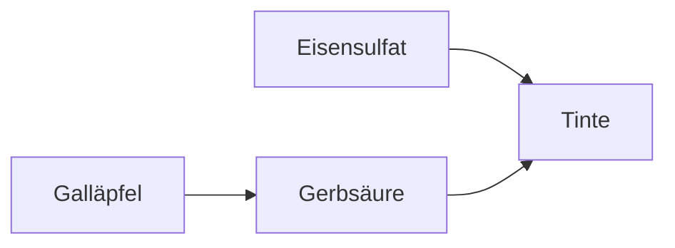

# Notizen über Tinte

Ein Dokument mit Umlauten im Namen: geschlossen und wieder geöffnet muss es
denselben Pfad haben.

## Farben

- Blau-Schwarz (Eisengallus)
- Sepia
- Grün, für Korrekturen

## Werkzeuge

| Werkzeug | Zweck |
| -------- | ----- |
| Feder | Schreiben |
| Pinsel | Lavieren |
| Löschpapier | Trocknen |

> Wer schreibt, der bleibt.

Letzte Zeile.
