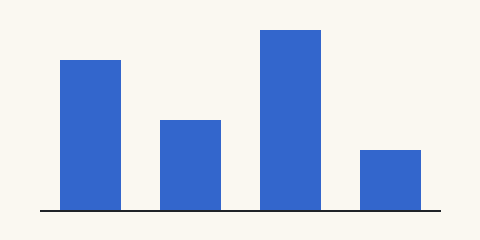

# Citing as you type {#sec:intro}

Typing `[@` or an `@` that starts a word lists the library's keys, and
`@fig:` lists this paper's figures. Literate programming began with a paper
[@knuth1984], and **big teams** are slow for reasons [see @brooks1995,
pp. 33-35]. As @fig:nib shows, ink leaves the slit first (@eq:flow).

## Figures and tables {#sec:figures}

{#fig:nib}

{#fig:bars}

Table: Inks measured, by density {#tbl:inks}

| Ink | Density (g/ml) | Source |
| --- | -------------: | ------ |
| Iron gall | 1.020 | [@lafontaine1668] |
| Carbon | 1.010 | @calvino1981 |

## Equations {#sec:equations}

$$ Q = \frac{\pi r^4 \Delta p}{8 \mu L} $$ {#eq:flow}

$$ h = \frac{2 \gamma \cos\theta}{\rho g r} \tag{2} \label{eq:rise} $$

- A list item citing @okafor2021, with *emphasis* and [@tbl:inks]
- An address that stays text: write to okafor@example.org
- A [link to pandoc's manual](https://pandoc.org/MANUAL.html#citations)

> A quote with its source [@frank2019, p. ix].

```python
def cite(key):
    return "[@" + key + "]"  # code: nothing completes here
```

The last paragraph.
