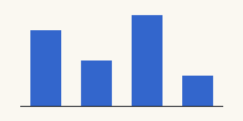

# Numbered figures, tables and equations

Figures, tables and equations number themselves in the order they appear,
the way pandoc-crossref numbers them. Everything below is ordinary
Markdown around them.

## A figure

{#fig:nib}

An image without an id stays a plain image, with no caption:



## A table, captioned above

Table: Ink densities by brand, at 20 °C {#tbl:density}

| Brand | Density (g/ml) | Notes |
| ----- | -------------: | ----- |
| Iroshizuku | 1.002 | **thin**, flows well |
| Noodler's | 1.015 | `bulletproof` |
| Diamine | 1.004 | wide range |

## A table, captioned below

| Paper | Feathering |
| ----- | ---------- |
| Tomoe River | none |
| Copy paper | heavy |

: Paper against feathering {#tbl:paper}

A table with a caption but no id keeps its words, unnumbered:

Table: Without a number

| A | B |
| - | - |
| 1 | 2 |

## Equations

The surface tension holds the ink in the slit:

$$ \gamma = \frac{F}{2L} $$ {#eq:tension}

> Inside a quote, the capillary rise:
>
> $$ h = \frac{2 \gamma \cos\theta}{\rho g r} $$ {#eq:rise}

- A list item with an equation numbered by hand keeps its own tag:

  $$ Q = \frac{\pi r^4 \Delta p}{8 \mu L} \tag{P} $$ {#eq:poiseuille}

A second figure:

{#fig:bars}

```python
def density(mass, volume):
    return mass / volume
```

Last line.
