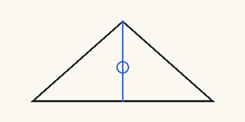

# 墨水与纸张

关于钢笔书写的研究由来已久[@zhang2020; @wang2019]，近年的工作更加深入
[@li2021, p. 12; @chen2023]。英文文献同样重要[@knuth1984; @doe2024]。

## 方法

毛细上升高度见 @eq:rise，笔尖结构见 @fig:nib。

$$ h = \frac{2 \gamma \cos\theta}{\rho g r} $$ {#eq:rise}

{#fig:nib}

Table: 墨水密度 {#tbl:density}

| 墨水 | 密度 |
| ---- | ---: |
| 铁胆墨水 | 1.020 |
| 碳墨 | 1.010 |

> 好墨水能弥补差的笔[@zhang2020]。

- 第一点：纸张结构[@wang2019]
- 第二点：墨水化学[@li2021]

## 结论

如 @tbl:density 所示，结果与文献一致[@zhang2020; @wang2019; @li2021]。
