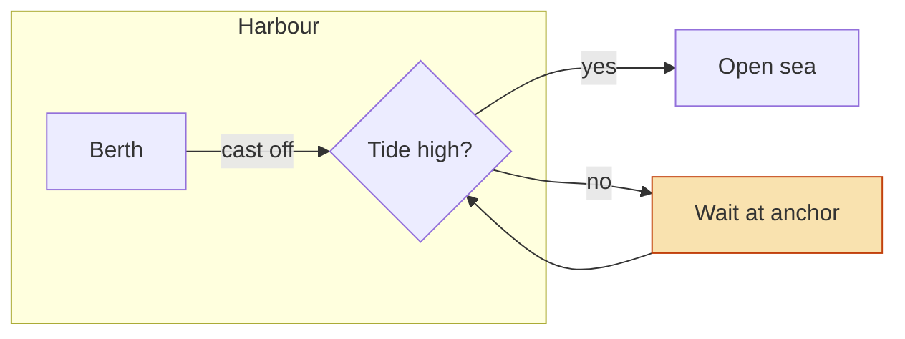
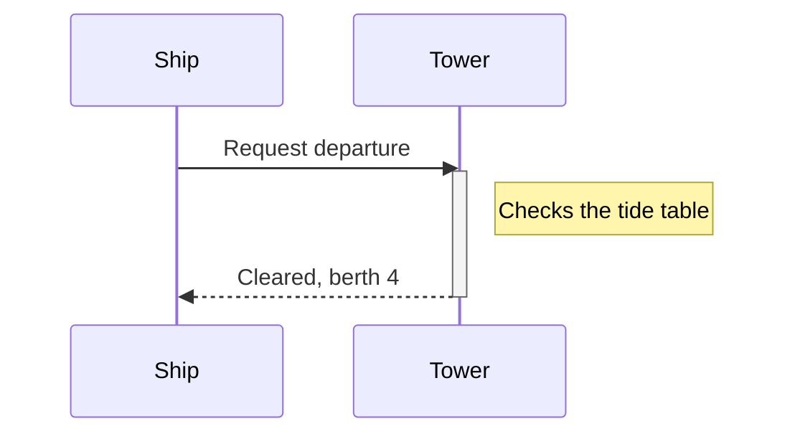
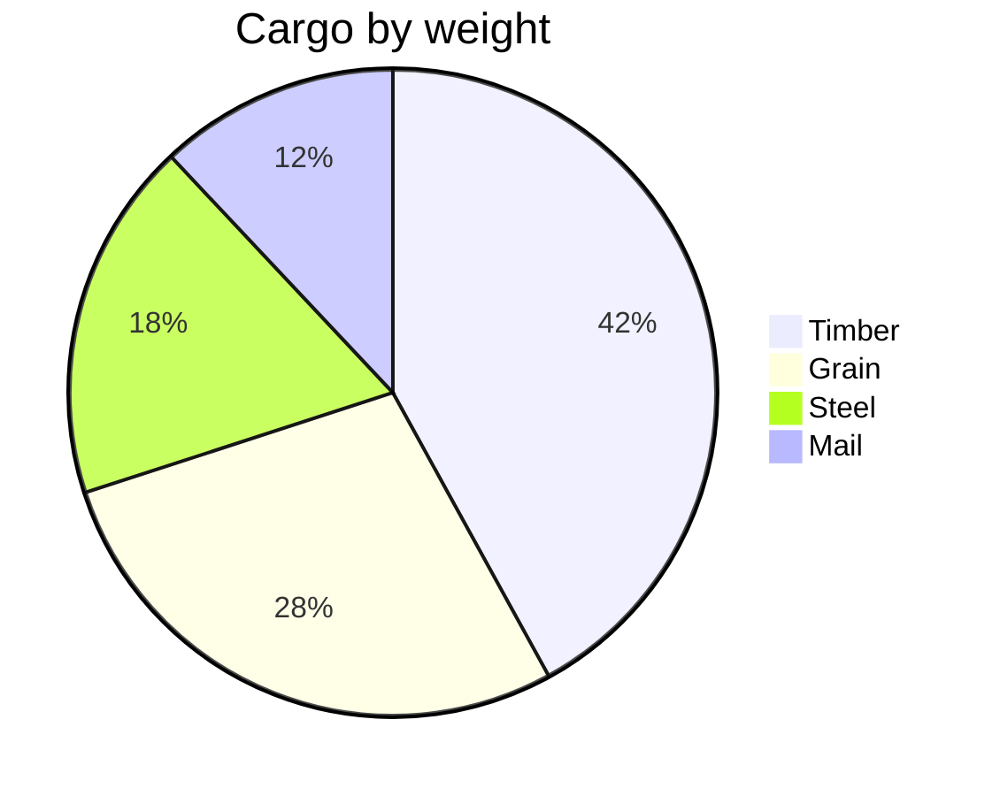

# Harbour log

A page for **chrome.css**: with it as the theme, the tab strip, the caption,
the side panels, menus and cards around this page take the sheet's `--ui-*`
colours, and the three diagrams below its `--mermaid-*` ones. *Everything
else* on the page keeps the page's colours. The
[themes page](../../../docs/css-themes.md) lists the variables.

## Departures

| Ship | Berth | Leaves |
| --- | --- | --- |
| *Tern* | 4 | 06:10 |
| **Gannet** | 7 | 09:45 |
| `Skua` | 2 | 13:20 |

> The harbour master signs every departure. Late ships wait for the tide.

- [x] Fuel checked
- [ ] Charts updated
  - Coastal sheet `NO-14`
  - Tide table for **March**

## The route

A flowchart with a subgraph, labelled edges and one node styled in the
diagram itself, which keeps its own colours over the sheet's.



## Radio



## Cargo



## The tide

```python
def tide(hour):
    # High for the first six hours of each twelve
    return "high" if hour % 12 < 6 else "low"
```

1. Read the gauge
2. Compare with `tide(hour)`
3. Signal the tower

A last paragraph with a [link to the top](#harbour-log), ==a mark==, and
~~a struck word~~.
