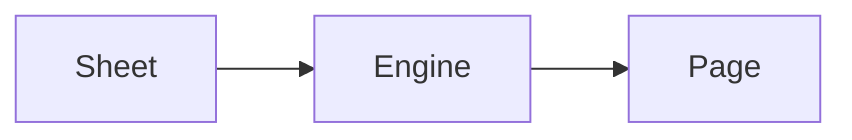

# A page for CSS themes

Open this page with each sheet in this folder as the theme: `paper-light.css`,
`night-dark.css`, `ink-light-dark.css` (switch Windows between light and dark)
and `mistakes.css` (Settings > Appearance lists its problems with their lines).
Every element a selector can name appears below, with **strong**, *emphasis*,
***both***, ~~struck~~, ==marked== and `inline code` text and a
[link](https://example.com) inside a paragraph.

## Lists

- First level, with a [link inside a list](#tables)
  - Second level, where `ul ul > li::marker` draws a dash
    - Third level
- Back at the first level

1. Numbered
   1. Lower alpha in Paper Light
   2. Second
2. Numbered again

- [ ] An open task
- [x] A done task, whose checkbox is `:checked`

## Tables

| Row | Name | Note |
| --- | --- | --- |
| 1 | odd | `tr:nth-child(odd)` in Night |
| 2 | even | `tr:nth-child(even) td` in Ink |
| 3 | odd | **bold in a cell** |
| 4 | even | *emphasis in a cell* |

## Quotes and callouts

> A quote with *emphasis* and `code`, which Ink sets in italic
> with a bar on its left.

> [!NOTE]
> A note: `blockquote.alert-note > p.alert-title`.

> [!WARNING]
> A warning, with a [link](https://example.com).

## Code

```python
def greet(name):
    # a comment, coloured by .token.comment
    return f"Hello, {name}!"  # a string
```

## Maths and a diagram

Inline $e^{i\pi} + 1 = 0$ and display maths:

$$
\int_0^1 x^2\,dx = \frac{1}{3}
$$



---

Footnotes close the page.[^1]

[^1]: A footnote: `section.footnotes > div.footnote`.
